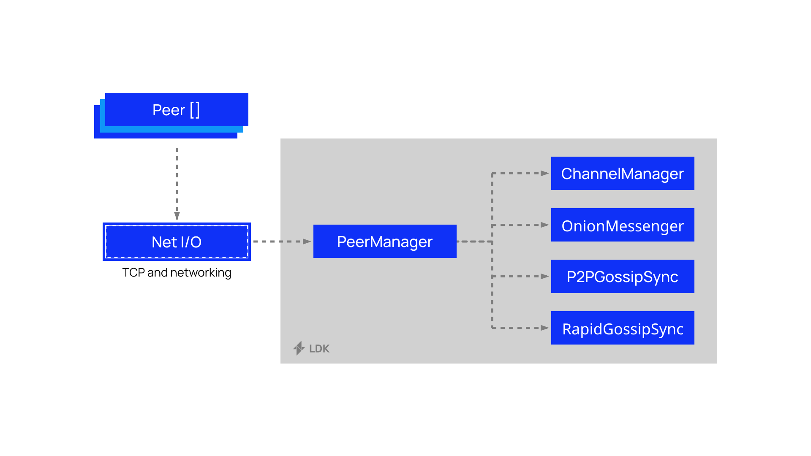
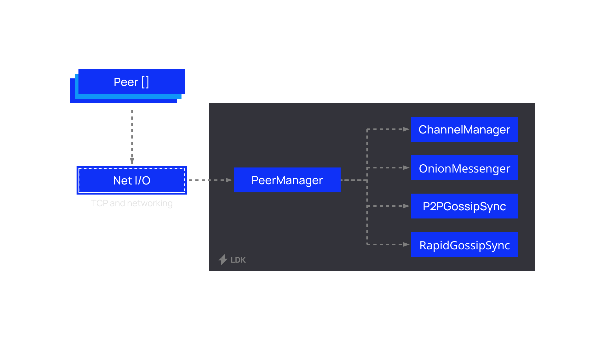

# Peer Management

One of the first things you'll need to do when building your own Lightning node is connect to a peer. In LDK this is handled by the [`PeerManager`](https://docs.rs/lightning/*/lightning/ln/peer_handler/struct.PeerManager.html).

The `PeerManager` uses message handlers to coordinate channel activity and gossip:
 - A [`ChannelManager`](https://docs.rs/lightning/*/lightning/ln/channelmanager/index.html) that enables it to notify peers when it wants to do things such as open channels.
 - For peer-to-peer gossip, a [`P2PGossipSync`](https://docs.rs/lightning/*/lightning/routing/gossip/struct.P2PGossipSync.html) processes and relays gossip messages from connected peers.

Since LDK knows nothing about your networking stack, you'll need to implement your own networking logic in order to connect to peers on the network. Provide LDK with raw TCP/IP socket data and the library will handle the rest for you.

LDK also handles a number of background tasks that need to happen periodically via [`BackgroundProcessor`](https://docs.rs/lightning-background-processor/*/lightning_background_processor/struct.BackgroundProcessor.html)

## Rapid Gossip Sync

Rapid Gossip Sync (RGS) applies compact updates from a server to a local
Lightning routing graph. It can reduce startup time and bandwidth for mobile
nodes. The client relies on the server to validate the underlying gossip, so
choose a server you trust to supply accurate graph data for your Bitcoin
network. Peer connections and blockchain synchronization still run separately.

With **LDK Node**, set the server URL with
[`Builder::set_gossip_source_rgs`](https://docs.rs/ldk-node/latest/ldk_node/struct.Builder.html#method.set_gossip_source_rgs)
before building the node. LDK Node fetches and applies updates in the
background.

With **a custom LDK integration**, use a
[`RapidGossipSync`](https://docs.rs/lightning-rapid-gossip-sync/latest/lightning_rapid_gossip_sync/struct.RapidGossipSync.html)
instance that shares the router's `NetworkGraph`. Request an update using
the graph's
[`get_last_rapid_gossip_sync_timestamp`](https://docs.rs/lightning/latest/lightning/routing/gossip/struct.NetworkGraph.html#method.get_last_rapid_gossip_sync_timestamp)
value, or zero for a fresh graph. Pass the binary response to
`update_network_graph` and use its returned timestamp for the next request.
Advance the timestamp only after a successful update. Persist the updated
graph so the node can resume incremental sync after a restart.

See [Announcing Rapid Gossip Sync](/blog/announcing-rapid-gossip-sync) for how
snapshots are produced and how the trust model differs from peer-to-peer gossip.

::: tip Default Implementation

If you are developing in a Rust [Tokio](https://tokio.rs/) environment, LDK ships with a socket handling [crate](https://docs.rs/lightning-net-tokio/*/lightning_net_tokio/) that let's you easily create new connections with peers. 

